# November 2026 - Client feedback, fixes and screens

Updated: 11 November 2026.

This page lists your November feedback, the improvements prepared, where to find them and what still needs your confirmation.

**13 points: 10 ready for review, 1 needs bank-detail confirmation and 2 are pending cleanup approval.**

Changes marked **Ready for review** need to be checked on your portal before you accept them.

## November review status

- **Prepared for review:** the November entry improvements and the earlier overdue-reminder/supplier-recovery improvements. Follow the screen checks below with the portal administrator.
- **Still needs your confirmation:** the exact IBAN, old login list and old master-entry list. Confirm the bank value privately and approve the exact records to keep or deactivate.
- **Portal availability:** confirm which options are enabled before the walkthrough. An updated guide alone does not activate every screen option.
- **Finance setup:** supplier recovery needs Finance's dedicated advance account; daily overdue reminders need the administrator to activate their schedule.
- **Client acceptance:** check each point using your own login and real business task, then record Accepted or Needs a change beside its ID.

**بالعربية:** التحسينات البرمجية المؤكدة جاهزة للمراجعة، لكن إغلاق جميع الملاحظات يتطلب تأكيد رقم IBAN وقوائم الحسابات والبيانات القديمة. تأكد من مسؤول البوابة من تفعيل الخيارات قبل التجربة، ثم سجّل قبولك أو التعديل المطلوب لكل نقطة.

## Reported issue versus fix

On a phone, swipe the table sideways to read every column. Menu names below use the English interface. Choose Arabic from the application language selector for the corresponding Arabic screens.

| Point | What the client reported | Fix / improvement prepared | Where to find it | How the client can check | Status |
| --- | --- | --- | --- | --- | --- |
| R10-01 | “My IBAN is correct, but the system says it is invalid.” | Copied spaces, invisible spacing and Arabic/Persian digits are handled. Format errors and check-digit errors have clearer messages. Incorrect check digits are still refused. | Employees → Open/Edit → Salary & payment → IBAN. | Copy the complete IBAN from the bank document and save. If it is still refused, compare the exact value privately with that document. | **NEEDS CONFIRMATION:** compare the exact IBAN with the bank document. |
| R10-02 | “Leave is approved, but the balance still shows 21 days.” | The balance clearly identifies its calendar year. Only approved **Annual Leave** reduces that year's annual balance. Pending days are shown separately. | Employees → View → leave balance and year links; Open/Edit → Leaves. Also My Leave → year selector. | With 21 days available and 3 approved Annual Leave days in the same year, remaining leave is 18. Personal Leave does not reduce it. | **READY FOR REVIEW** |
| R10-03 | “I cannot add an employee profile picture.” | Added photo selection, preview, save, replacement and removal. | Employees → Open/Edit → Personal → photo. | Choose a photo, save, reopen and check it. To remove it, select Remove saved photo and save. | **READY FOR REVIEW** |
| R10-04 | “The photo/plus button on Add User does nothing.” | The chooser now uploads a photo. The saved user photo appears in the profile, topbar and sidebar. | Users → Add User; or Users → Edit / Manage → Profile. | Choose a photo, save and reopen the user. Employee and User account photos are separate. | **READY FOR REVIEW** |
| R10-05 | “Two people with the same role need different access, especially a new employee.” | Super Admin can set **Inherit, Allow or Deny** for one user, with a required reason and an audit record. Deny takes priority over role grants. | Users → that person → Edit / Manage → expand Individual permissions below Profile. | Give one user a Deny exception. Check that this action is blocked for that person while another person with the same role keeps their normal access. | **READY FOR REVIEW** |
| R10-06 | “Keep my login and Super Admin; remove the old demo logins.” | A list of old accounts is to be reviewed with the owner. No account has been removed or deactivated. | Users - review the account list with the owner. | Confirm your login and the Super Admin account to keep, then approve which demo accounts to deactivate. | **PENDING:** confirm the accounts to keep before deactivation. |
| R10-07 | “Old projects, sites and other entries make new entry confusing.” | Old entries are to be reviewed before cleanup. Recently entered real records must be kept. | Projects, Sites and the relevant master lists - review with the owner. | Mark each item Keep or Review. Protect newly entered real records before approving any cleanup. | **PENDING:** confirm which old entries to keep or remove. |
| R10-08 | “Where can I request leave using my own login?” | Added **My Leave** for a user linked to one eligible HR employee. It shows their own requests, status and annual balance. New requests remain Pending. | Topbar → My Leave. If missing, HR checks the linked Employee in User Manage. | Sign in as the linked employee, choose a leave type and dates, and submit. Check that only that employee's records are shown. Approval remains a separate HR action. | **READY FOR REVIEW** |
| R10-09 | “Customer and Supplier codes should appear automatically, like Employee codes.” | Added the next-code preview, automatic numbering and an optional manual-code choice. Save & New shows the next preview. Saved old codes are unchanged. | Customers → Add Customer → Code; Suppliers → Add Supplier → Code. | Leave Enter my own code instead unchecked. Save the record, then use Save & New for another. The final saved code may advance if another user saves first. | **READY FOR REVIEW** |
| R10-10 | “There is no place to attach Supplier papers.” | Added private document uploads, type, reference and dates, plus View and Download for saved files. | Suppliers → Add Supplier or Edit / Manage → Documents. Supplier View shows saved files without upload controls. | Add a document row and select a file. Save the supplier, reopen and use View or Download. | **READY FOR REVIEW** |
| R10-11 | “Customer papers should be attached to the Customer.” | Added the same private document facility for Customers. View stays read-only. | Customers → Add Customer or Edit / Manage → Documents; View → saved documents. | Select a file and save the customer. Confirm that it can be viewed and downloaded from that customer's record. | **READY FOR REVIEW** |
| R10-12 | “For Equipment documents, I must save first and move to View. Keep them on the entry screen.” | Equipment documents can now be added with initial asset entry or in Edit. Saved documents are listed on the form. | Equipment & Vehicles → Add Equipment or Edit → Documents. | Enter the asset details, select a document and save once. Reopen the asset and check its saved document. | **READY FOR REVIEW** |
| R10-13 | Equipment showed a 500 Server Error. | The prepared fix saves a blank initial meter as 0. Entered readings are kept; negative readings receive a clear message. | Equipment & Vehicles → Add Equipment → initial/current meter reading. | Save a valid training asset with a blank initial meter and check that it saves as 0. A positive entered reading must remain unchanged. | **READY FOR REVIEW** |

## Rules confirmed with the owner

| Topic | Agreed behaviour |
| --- | --- |
| Annual balance | Deduct only approved Annual Leave for the selected calendar year. Do not deduct Urgent/Personal Leave. No automatic carry-forward was introduced. |
| Individual access | Inherit role access by default. Super Admin alone manages personal Allow/Deny exceptions and supplies a reason. Deny takes priority. |
| Record access | Personal Allow does not widen project, site or warehouse scope, revive an expired role assignment, or make someone Super Admin. |
| Old users and data | Inventory first. Review exact IDs and retained accounts before approving deactivation or cleanup. |
| HR dates and later raises | Keep calendar-day counting and explicit new effective-dated salary structures. No automatic carry-forward or accrual. |
| Overdue reminders | In-app reminder each day from one day overdue, for authorized Finance/Super Admin users. Stop showing the reminder when the invoice is settled. |

The supplied leave example was **9 days of Urgent / Personal Leave in August 2025**, while the balance shown was **Annual Leave for 2026**. Under the owner's confirmed rule, that leave must not reduce the 2026 annual balance.

## Other changes the client should know

| Detail | What it means for the user |
| --- | --- |
| Employee and User photos | Both can be uploaded, but one does not automatically copy to the other. |
| Upload limits | Photos: JPG, PNG or WebP, up to 4 MB. Documents: PDF, JPG, PNG or WebP, up to 10 MB each and 10 files per save. Select files again after a validation error. |
| Saving documents | Save the parent Customer, Supplier or Equipment form to store its selected files. Uploading a paper does not approve, post or pay a transaction. |
| Customer removal | A customer with saved documents is protected from direct deletion. Use Inactive when appropriate to retain the record and files. |
| Permissions and probation | Personal exceptions remain until Super Admin changes them. No automatic probation-end schedule was added. The shared Permission Matrix still changes the role for everyone. |
| Super Admin protection | Ordinary User/Role permissions cannot be used to assign the Super Admin role or modify its protected account or role. |

## Earlier feedback included in this review

| Point | What you asked for | Improvement prepared | Screen / example | Status |
| --- | --- | --- | --- | --- |
| NR-06 | Remind Finance when a customer invoice is overdue | One in-app reminder per authorized user/invoice/day, starting one day after the due date. An inaccessible or settled invoice is excluded. | Notifications → Open invoice. An invoice due on 10 November starts reminders on 11 November. | Ready for portal review after activation. |
| NR-29 | Track supplier advances, salaries and repairs paid on their behalf | A separate recoverable balance, explicit application to a posted bill, supplier refund and reversals. Each action keeps a journal and history. | Suppliers → Edit / Manage → Supplier advances. Advance 1,000; apply 400; receive 100 back; available 500. | Ready for Finance review; Finance must map its dedicated advance asset account first. |
| Latest screenshot | User action displays `ui.deactivate` | Readable English Deactivate and Arabic تعطيل labels. | Users → Actions. | Ready for portal review. |
| Latest screenshot | Supplier says there are no projects | The empty message now explains that no projects are available to the current account. Setup and role scope are checked before creating or linking real records. | Supplier → Projects. | Message corrected; your real project/role combination still needs a walkthrough. |
| Latest screenshot | Employee code appears reused in the user list | The private owner review distinguishes displayed codes from actual Employee links and lists conflicts. It does not change identities automatically. | Owner-assisted Users review. | Confirm exact identities before correction or deactivation. |

Supplier salary/repair recovery requires an agreed right to recover the payment. A newly taxable charge is not automatically treated as a tax-free deduction. Existing bill VAT and previous payments stay unchanged.

<!-- NOVEMBER_SCREENSHOTS_START -->
## Screenshots: where each change is

These are real application screenshots captured on **11 November 2026** using **fictional training data**. They show the prepared improvements. They do not mean these changes are already installed on your live website. Live screen links below require your normal authorized login; select your own record where indicated. Training record IDs are not live-record links.

| Point | Screenshot / screen | Open screen |
| --- | --- | --- |
| R10-03 | [Employee profile photo](#screenshot-employee-photo) | [Open](https://seera.tech-brit.co.uk/admin/hr/employees) |
| R10-04 | [User account photo](#screenshot-user-photo) | [Open](https://seera.tech-brit.co.uk/admin/users/create) |
| R10-02 | [Annual leave balance and year](#screenshot-annual-leave) | [Open](https://seera.tech-brit.co.uk/admin/hr/employees) |
| R10-01 | [Employee bank details](#screenshot-iban) | [Open](https://seera.tech-brit.co.uk/admin/hr/employees) |
| R10-05 | [Individual access for one user](#screenshot-personal-permissions) | [Open](https://seera.tech-brit.co.uk/admin/users) |
| R10-08 | [Request your own leave](#screenshot-my-leave) | [Open](https://seera.tech-brit.co.uk/admin/my-leave) |
| R10-09 | [Automatic Supplier code](#screenshot-supplier-code) | [Open](https://seera.tech-brit.co.uk/admin/master/suppliers/create) |
| R10-09 | [Automatic Customer code](#screenshot-customer-code) | [Open](https://seera.tech-brit.co.uk/admin/master/customers/create) |
| R10-10 | [Supplier papers on the entry screen](#screenshot-supplier-documents) | [Open](https://seera.tech-brit.co.uk/admin/master/suppliers/create) |
| R10-11 | [Customer papers on the entry screen](#screenshot-customer-documents) | [Open](https://seera.tech-brit.co.uk/admin/master/customers/create) |
| R10-12 | [Equipment documents during initial entry](#screenshot-equipment-documents) | [Open](https://seera.tech-brit.co.uk/admin/equipment/create) |
| R10-13 | [Equipment initial meter](#screenshot-equipment-meter) | [Open](https://seera.tech-brit.co.uk/admin/equipment/create) |
| R10-06 / latest screenshot | [Old-user review and readable Deactivate action](#screenshot-users-review) | [Open](https://seera.tech-brit.co.uk/admin/users) |
| R10-07 | [Master records to review before cleanup](#screenshot-master-review) | [Open](https://seera.tech-brit.co.uk/admin/accounting/cost-centers) |
| NR-06 | [Customer overdue reminder](#screenshot-overdue-reminder) | [Open](https://seera.tech-brit.co.uk/admin/notifications) |
| NR-29 | [Supplier recoverable payment and settlement](#screenshot-supplier-recovery) | [Open](https://seera.tech-brit.co.uk/admin/master/suppliers) |

### R10-03 — Employee profile photo

**What changed:** Choose, preview, save, replace or remove an Employee photo.

**Where:** Open the employee → Personal. [Open this screen](https://seera.tech-brit.co.uk/admin/hr/employees).

**Status:** Prepared and tested; check portal availability with the administrator, then record your acceptance.

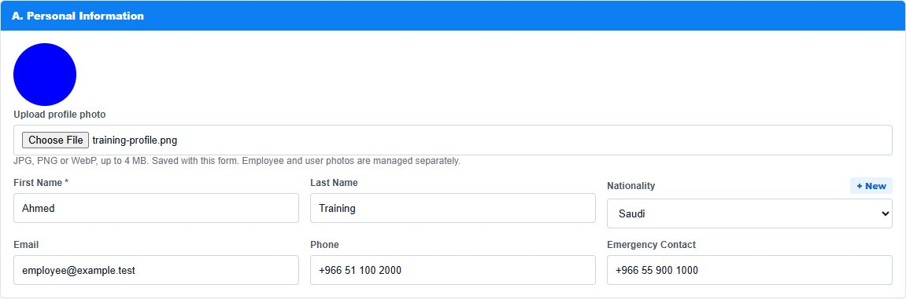

Arabic screenshot / الصورة العربية

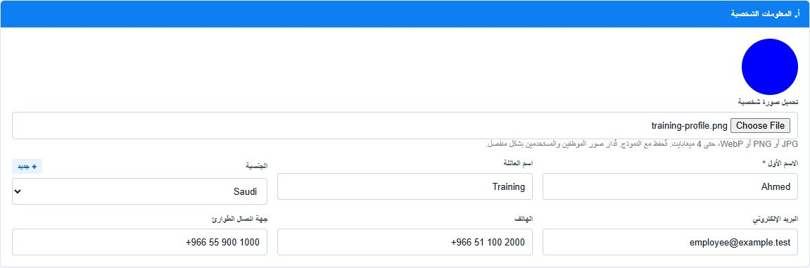

### R10-04 — User account photo

**What changed:** The photo chooser now works and shows a preview. Save the user to keep the selected photo.

**Where:** Profile photo on Add User; also available on Edit / Manage. [Open this screen](https://seera.tech-brit.co.uk/admin/users/create).

**Status:** Prepared and tested; check portal availability with the administrator, then record your acceptance.

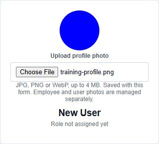

### R10-02 — Annual leave balance and year

**What changed:** The selected year and Annual Leave balance are explicit. Only approved Annual Leave in that year reduces the annual balance.

**Where:** Open the employee → View → leave balance/year. [Open this screen](https://seera.tech-brit.co.uk/admin/hr/employees).

**Status:** Prepared and tested; check portal availability with the administrator, then record your acceptance.

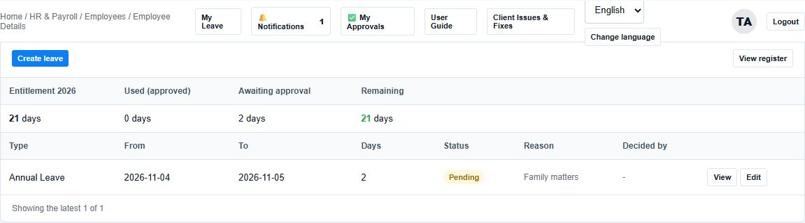

### R10-01 — Employee bank details

**What changed:** Copied spaces and Arabic/Persian digits are normalized; format/check-digit errors are explained.

**Where:** Open the employee → Salary & payment → IBAN. [Open this screen](https://seera.tech-brit.co.uk/admin/hr/employees).

**Status:** Needs private confirmation of the exact disputed bank value. This screenshot shows the form, not bank ownership verification.

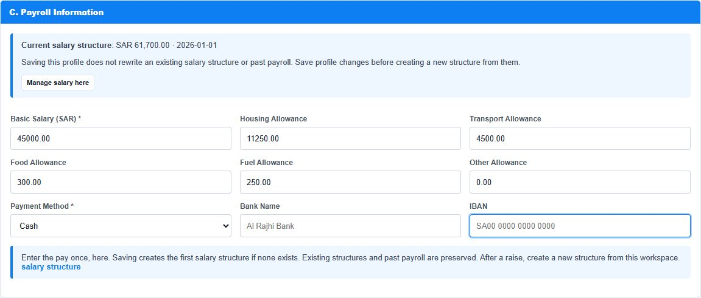

### R10-05 — Individual access for one user

**What changed:** Super Admin can set Inherit / Allow / Deny for one person with a reason. A personal Deny takes priority over role grants.

**Where:** Choose the user → Edit / Manage → Individual permissions. [Open this screen](https://seera.tech-brit.co.uk/admin/users).

**Status:** Prepared and tested; check portal availability with the administrator, then record your acceptance.

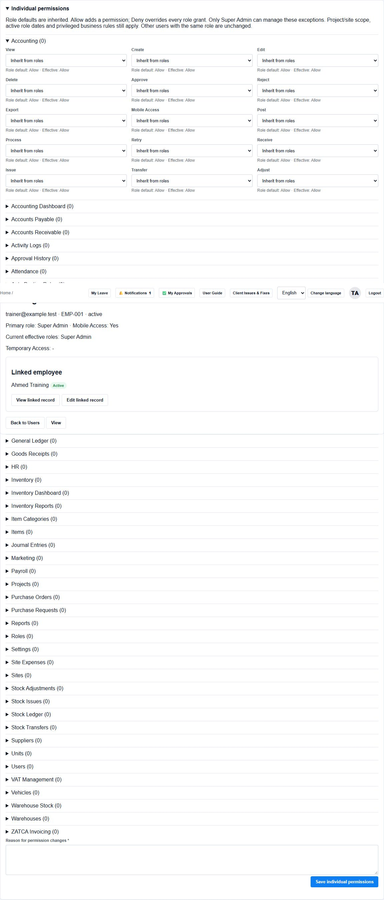

Arabic screenshot / الصورة العربية

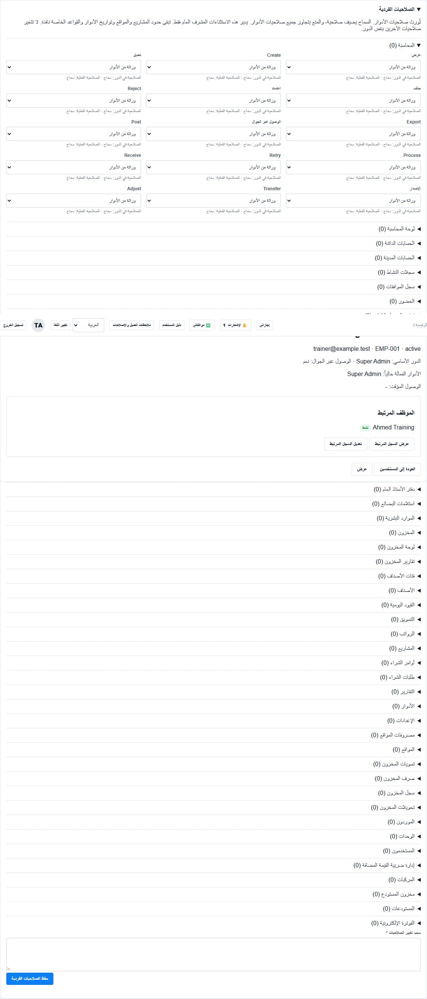

### R10-08 — Request your own leave

**What changed:** The linked employee sees their own requests and balance. New requests remain Pending for HR approval.

**Where:** Topbar → My Leave. A unique eligible Employee link is required. [Open this screen](https://seera.tech-brit.co.uk/admin/my-leave).

**Status:** Prepared and tested; check portal availability with the administrator, then record your acceptance.

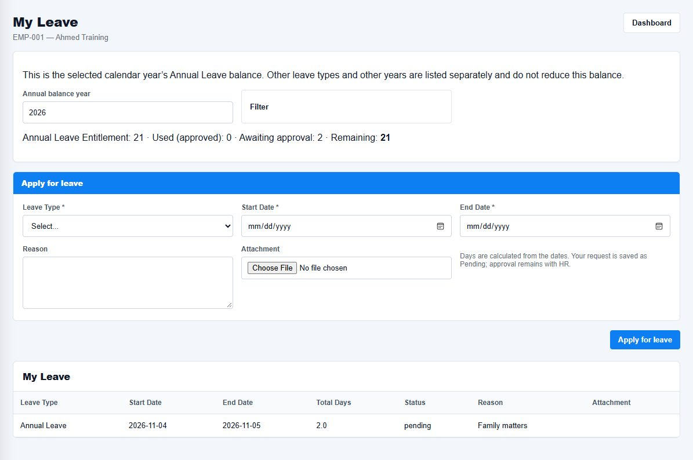

### R10-09 — Automatic Supplier code

**What changed:** The next expected code is visible. The server allocates the final code on save; Save & New refreshes the preview.

**Where:** Add Supplier → Code. Leave the manual-code checkbox unchecked. [Open this screen](https://seera.tech-brit.co.uk/admin/master/suppliers/create).

**Status:** Prepared and tested; check portal availability with the administrator, then record your acceptance.

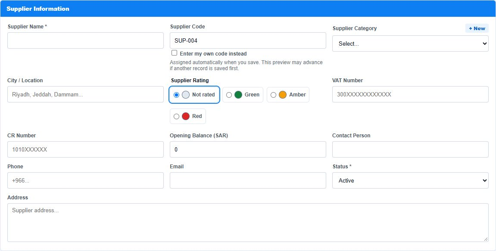

### R10-09 — Automatic Customer code

**What changed:** The same preview/manual-code choice is available for Customers. Existing saved codes are preserved.

**Where:** Add Customer → Code. [Open this screen](https://seera.tech-brit.co.uk/admin/master/customers/create).

**Status:** Prepared and tested; check portal availability with the administrator, then record your acceptance.

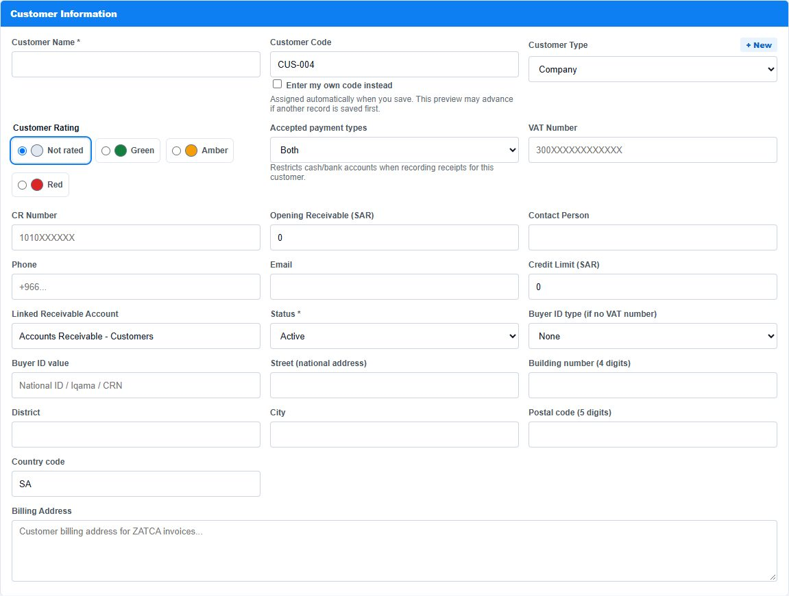

### R10-10 — Supplier papers on the entry screen

**What changed:** Choose document type, reference, dates and file together with the supplier. Save the parent form to store it.

**Where:** Add Supplier or Edit / Manage → Documents. [Open this screen](https://seera.tech-brit.co.uk/admin/master/suppliers/create).

**Status:** Prepared and tested; check portal availability with the administrator, then record your acceptance.

Arabic screenshot / الصورة العربية

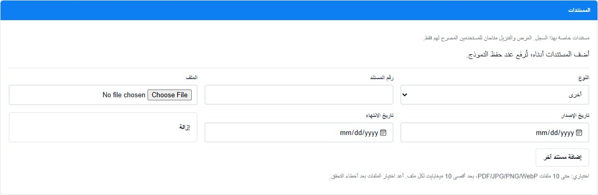

### R10-11 — Customer papers on the entry screen

**What changed:** Customer documents stay with their Customer. Saved files have View/Download; Customer View stays read-only.

**Where:** Add Customer or Edit / Manage → Documents. [Open this screen](https://seera.tech-brit.co.uk/admin/master/customers/create).

**Status:** Prepared and tested; check portal availability with the administrator, then record your acceptance.

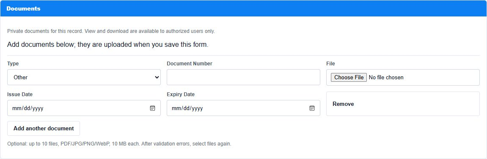

### R10-12 — Equipment documents during initial entry

**What changed:** Files can be selected before the first save, without moving to a separate View screen.

**Where:** Add Equipment → Documents. [Open this screen](https://seera.tech-brit.co.uk/admin/equipment/create).

**Status:** Prepared and tested; check portal availability with the administrator, then record your acceptance.

### R10-13 — Equipment initial meter

**What changed:** The server saves a blank initial meter as zero; entered readings are kept and negative readings are refused. This image identifies the affected field; the save behavior is covered by regression tests.

**Where:** Add Equipment → Initial meter reading. [Open this screen](https://seera.tech-brit.co.uk/admin/equipment/create).

**Status:** Prepared and tested; check portal availability with the administrator, then record your acceptance.

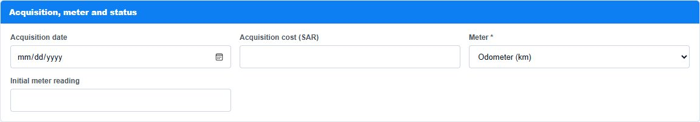

### R10-06 / latest screenshot — Old-user review and readable Deactivate action

**What changed:** The raw ui.deactivate text is replaced by a readable action. The owner inventory distinguishes displayed codes from actual Employee links.

**Where:** Users → review exact account IDs and Employee links with the owner. [Open this screen](https://seera.tech-brit.co.uk/admin/users).

**Status:** Actual cleanup and any identity correction are still pending the approved list. The fictional accounts pictured were not deleted or deactivated.

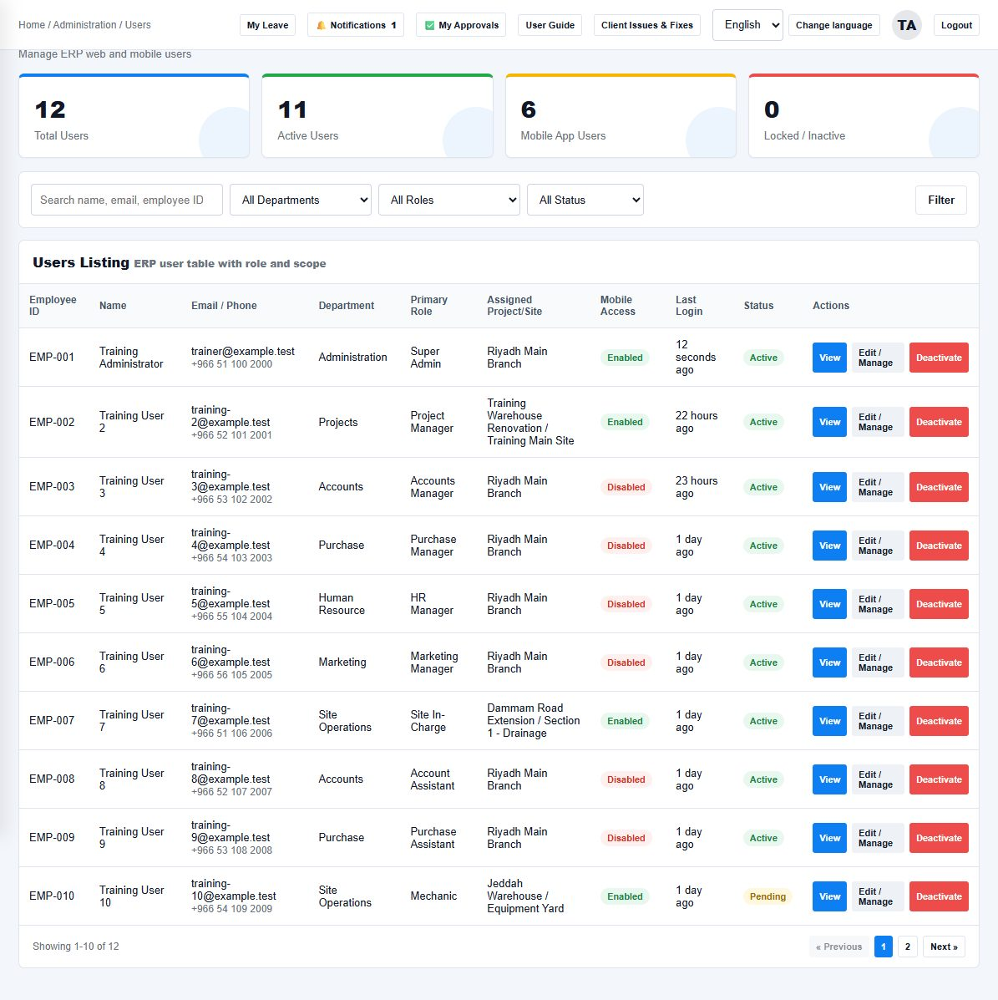

### R10-07 — Master records to review before cleanup

**What changed:** The private inventory identifies retained masters and missing linked references. Newly entered real records are protected from automatic cleanup.

**Where:** Review Cost Centers, Projects and Sites with the owner. [Open this screen](https://seera.tech-brit.co.uk/admin/accounting/cost-centers).

**Status:** Pending item-by-item Keep / Review decisions. This screenshot is a training list, not proof of completed cleanup.

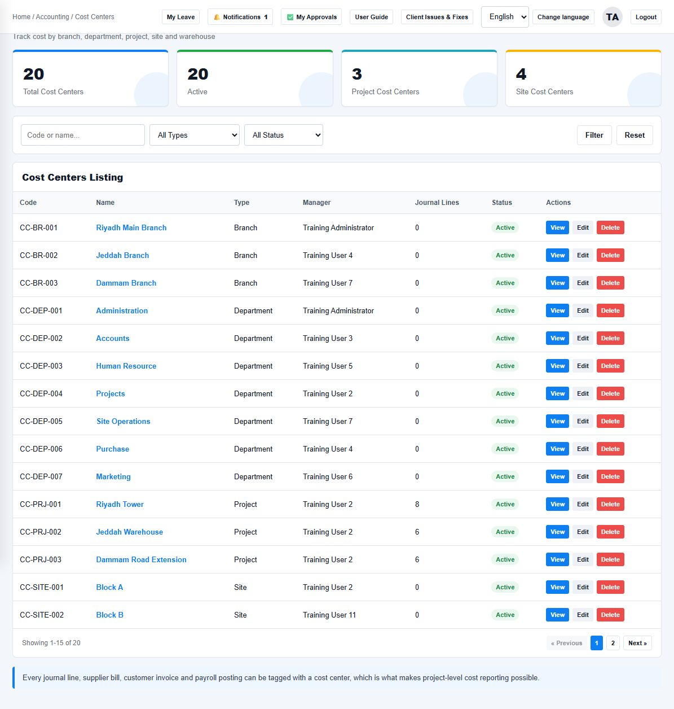

### NR-06 — Customer overdue reminder

**What changed:** After schedule activation, eligible Finance/Super Admin users receive one in-app reminder per overdue invoice/day from one day overdue. Settled or inaccessible invoices are excluded.

**Where:** Notifications → Open invoice. [Open this screen](https://seera.tech-brit.co.uk/admin/notifications).

**Status:** Prepared and tested; check portal availability with the administrator, then record your acceptance.

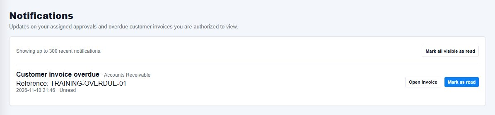

Arabic screenshot / الصورة العربية

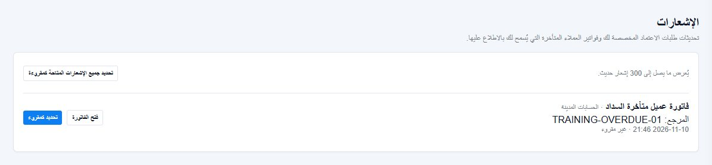

### NR-29 — Supplier recoverable payment and settlement

**What changed:** Record an agreed recoverable payment, explicitly apply it to an eligible bill, record money returned, or reverse a correction. Finance must configure its dedicated advance asset first.

**Where:** Choose supplier → Edit / Manage → Supplier advances. [Open this screen](https://seera.tech-brit.co.uk/admin/master/suppliers).

**Status:** Prepared and tested; check portal availability with the administrator, then record your acceptance.

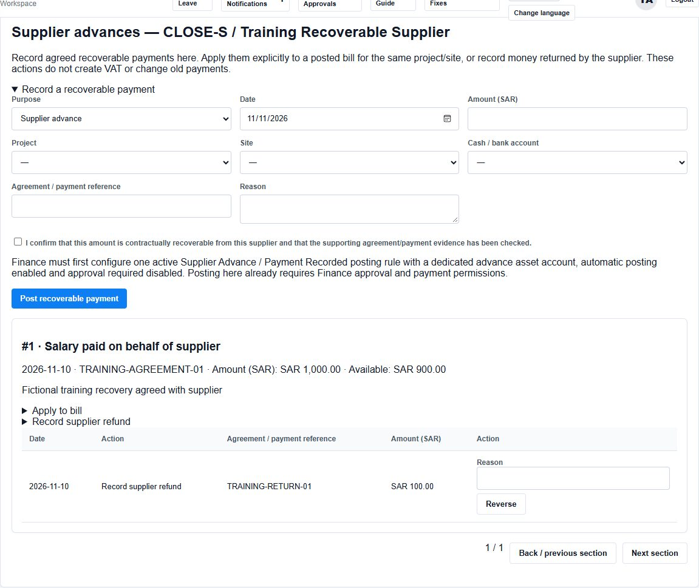

Arabic screenshot / الصورة العربية

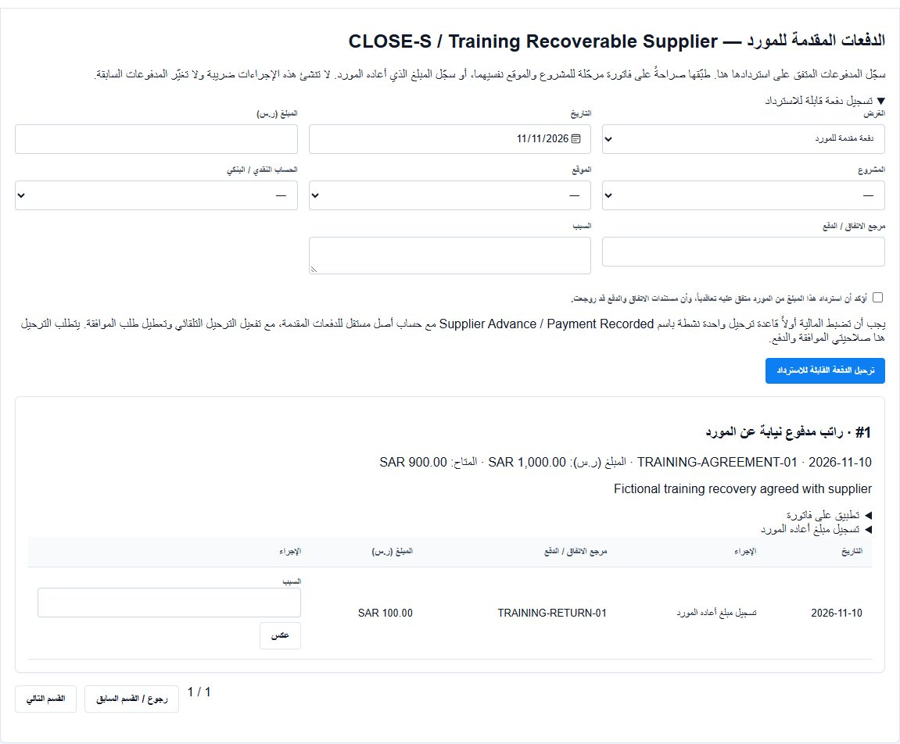

<!-- NOVEMBER_SCREENSHOTS_END -->
## Client confirmation checklist

1. Compare the disputed IBAN privately with the bank document.
2. Confirm the exact client and Super Admin accounts to keep, and which old demo accounts may be deactivated.
3. Confirm which old projects, sites and other entries to keep or remove. Protect newly entered real data.
4. Check each prepared improvement on your portal. Record **Accepted** or **Needs a change** against its point ID.

## November user instructions

[Open the November instructions](CLIENT-ENTRY-UPDATES-2026-11-10.md) for photos, documents, codes, leave and personal permissions.
